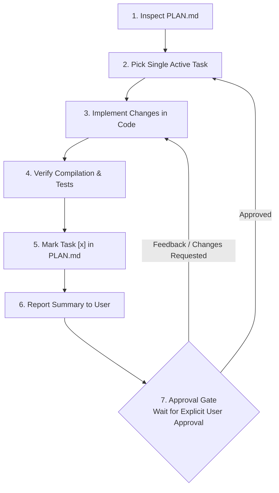
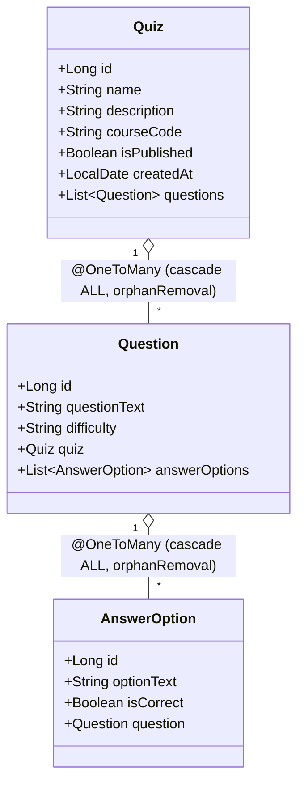

# AGENT.md — Developer & AI Operating Guidelines

This document governs the operational rules, architectural constraints, coding standards, and execution protocol for any developer or AI assistant working in the **Quizzer** repository.

---

## 1. Strict Working Agreement (The Approval Gate)



To maintain absolute transparency, incremental delivery, and prevent uncontrolled drift from user requirements, every contributor and AI agent must adhere to the **Approval Gate Protocol**:

1. **Check Before Writing**: Never write or modify code without inspecting [`PLAN.md`](./PLAN.md) first.
2. **Atomic Execution**: Execute **exactly ONE actionable task** at a time. Do not batch or bundle tasks together.
3. **Approval Gate**: After finishing a single task:
   - Run verification (compilation, unit tests, or server boot).
   - Update [`PLAN.md`](./PLAN.md) marking the task as completed (`[x]`).
   - Summarize what was accomplished, what files were touched, and any architectural observations.
   - **STOP and WAIT for explicit user approval** before proceeding to the next task.
4. **Documentation Synchronization**: Keep [`README.md`](./README.md), [`PROJECT_SPEC.md`](./PROJECT_SPEC.md), and [`PLAN.md`](./PLAN.md) synchronized whenever schema, API endpoints, or configurations change.

---

## 2. Architecture & Design Constraints

### 2.1 Backend Separation of Concerns
- **MVC Layer (`web`)**:
  - `QuizController`: Handles teacher web actions for Quizzes (CRUD operations using Thymeleaf templates).
  - `QuestionController`: Handles teacher web actions for Questions (listing, adding, deleting for a quiz).
  - `AnswerOptionController`: Handles teacher web actions for Answer Options (listing, adding, editing, deleting for a question).
  - `QuizRestController`: Handles JSON endpoints for the student dashboard (`/api/quizzes`).
- **Domain Layer (`domain`)**:
  - JPA entities: `Quiz`, `Question`, `AnswerOption`.
  - Spring Data JPA repositories: `QuizRepository`, `QuestionRepository`, `AnswerOptionRepository`.
- **View Layer (`src/main/resources/templates`)**:
  - Semantic HTML5 templates rendered via **Thymeleaf**.
  - All form submissions must use standard HTTP `POST` or `GET` redirects (Post/Redirect/Get pattern).

### 2.2 Entity Relationship & Serialization Safety



- **Relationships**:
  - `Quiz (1) <---> (N) Question`
  - `Question (1) <---> (N) AnswerOption`
- **Cascade & Orphan Removal**:
  - Deleting a `Quiz` must cascade delete all associated `Question`s.
  - Deleting a `Question` must cascade delete all associated `AnswerOption`s.
- **Circular JSON Recursion Guard**:
  - **CRITICAL**: To prevent infinite recursion and `StackOverflowError` when serializing entities into JSON for REST endpoints, always add `@JsonIgnore` on the `@OneToMany` collection side of bidirectional relationships (e.g., on `questions` in `Quiz`, and on `answerOptions` in `Question`).

### 2.3 Cross-Origin Resource Sharing (CORS)
- REST controllers serving the student dashboard must declare `@CrossOrigin(origins = "*")` to permit cross-origin requests from the React/Vite development server (`http://localhost:5173`).

---

## 3. Coding Standards & Conventions

### 3.1 Java & Spring Boot
- **Target Java Version**: Java 21 LTS. Use modern language features when appropriate (pattern matching, records for DTOs).
- **Naming Conventions**:
  - Java entity fields must be `camelCase` (e.g., `courseCode`, `isPublished`, `createdAt`), mapped to database columns via JPA naming conventions.
  - Classes must be `PascalCase` (`Quiz`, `QuestionRepository`, `QuizController`).
  - Package structure: `com.DevElite.Quiz.domain`, `com.DevElite.Quiz.web`.
- **Entity Constructors**:
  - Provide a default parameterless constructor for JPA reflection.
  - Provide convenient parameterized constructors for seeding and tests.
- **Defensive Design**:
  - Set meaningful defaults (e.g., difficulty defaults to `"Normal"`, `isPublished` defaults to `false`, `isCorrect` defaults to `false`).

### 3.2 Self-Documenting Code & Comprehensive Commenting Standards
- **Class-Level Javadoc**: Every class, interface, service, repository, and controller must have class-level Javadoc explaining its purpose, architectural role, and user stories it serves.
- **Method & Constructor Documentation**: Document all public methods, parameters (`@param`), return types (`@return`), and potential side effects.
- **Field & Annotation Explanation**: Annotate entity fields with comments detailing data constraints, relationships, cascade rules, and serialization tags (`@JsonIgnore`).
- **In-Line Rationale**: Use inline comments to explain non-obvious technical decisions (such as bidirectional relation management, cascade deletion order, and CORS configuration).
- **Self-Documenting Code**: Choose descriptive, intention-revealing variable and method names so code reads like clean prose while maintaining comprehensive comments.

### 3.3 HTML & Thymeleaf
- Use `th:href` and `th:action` for all dynamic links and form submissions.
- Use `th:field="*{fieldName}"` for form object binding.
- Ensure forms pass entity IDs through path variables or hidden inputs where required.
- Maintain clean, consistent UI styling with clear navigation breadcrumbs between Quizzes -> Questions -> Answer Options.

---

## 4. No-Go Patterns (Anti-Patterns)

- ❌ **NO Single-Page Application replacement for Teacher Dashboard**: The teacher interface must use Thymeleaf server-side templates as mandated by the course specifications. Do not convert the teacher UI to React.
- ❌ **NO Direct Database Coupling in Controllers**: Always access persistence via Spring Data JPA repository interfaces.
- ❌ **NO Raw SQL / JDBC**: Use Spring Data JPA repository query derivation (`findBy...`) or JPQL where necessary.
- ❌ **NO Unannotated JSON Bi-directional References**: Never expose entities with `@OneToMany` to REST serialization without `@JsonIgnore`.
- ❌ **NO Multiple-Task Execution**: Never proceed to a subsequent task in `PLAN.md` without presenting progress to the user and receiving permission.
- ❌ **NO Placeholder/Dummy Data in Production Demos**: All seed data for demo/review must represent realistic course quizzes (e.g., Scrum framework, Java fundamentals).

---

## 5. Testing Rules

- Testing framework: **JUnit 5** + **Spring Boot Test** (`spring-boot-starter-test`).
- Write unit/integration tests for:
  - Repository CRUD operations (`@DataJpaTest` or `@SpringBootTest`).
  - Web MVC controllers and HTTP status codes (`MockMvc`).
  - REST API responses (verifying only published quizzes are returned).
- Before claiming any milestone task as done, verify test execution:
  ```powershell
  .\mvnw.cmd test
  ```

