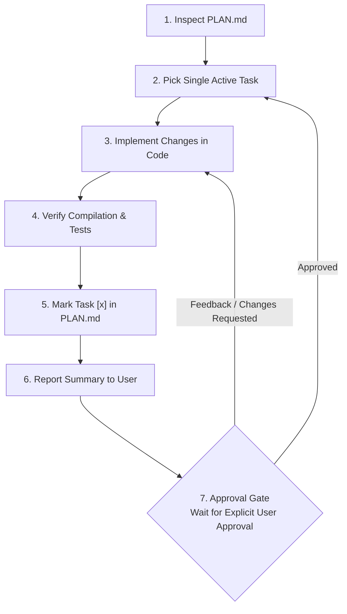

# AGENT.md — Developer & AI Operating Guidelines

This document governs the operational rules, architectural constraints, coding standards, and execution protocol for any developer or AI assistant working in the **Quizzer** repository.

---

## 1. Strict Working Agreement (The Approval Gate)



To maintain absolute transparency, incremental delivery, and prevent uncontrolled drift from user requirements, every contributor and AI agent must adhere to the **Approval Gate Protocol**:

1. **Check Before Writing**: Never write or modify code without inspecting [`PLAN.md`](./PLAN.md) first.
2. **Atomic Execution**: Execute **exactly ONE actionable task** at a time. Do not batch or bundle tasks together.
3. **Approval Gate**: After finishing a single task:
   - Run verification (compilation, unit tests, or server boot).
   - Update [`PLAN.md`](./PLAN.md) marking the task as completed (`[x]`).
   - Summarize what was accomplished, what files were touched, and any architectural observations.
   - **STOP and WAIT for explicit user approval** before proceeding to the next task.
4. **Documentation Synchronization**: Keep [`README.md`](./README.md), [`PROJECT_SPEC.md`](./PROJECT_SPEC.md), and [`PLAN.md`](./PLAN.md) synchronized whenever schema, API endpoints, or configurations change.

---

## 2. Architecture & Design Constraints

### 2.1 Backend & Frontend Separation of Concerns
- **Teacher MVC Controllers (`web`)**:
  - `QuizController`: Handles teacher web actions for Quizzes (CRUD operations and category assignment using Thymeleaf templates).
  - `QuestionController`: Handles teacher web actions for Questions (listing, adding, deleting for a quiz).
  - `AnswerOptionController`: Handles teacher web actions for Answer Options (listing, adding, editing, deleting for a question).
  - `CategoryController`: Handles teacher web actions for Categories (listing, adding, deleting with safe quiz detachment using Thymeleaf templates).
  - All MVC form submissions must use standard HTTP `POST` or `GET` redirects (Post/Redirect/Get pattern).
- **Student REST Controllers (`web`)**:
  - `QuizRestController`: Handles JSON endpoints for quizzes, quiz questions, and quiz results (`/api/quizzes`, `/api/quizzes/{id}`, `/api/quizzes/{id}/questions`, `/api/quizzes/{id}/results`).
  - `CategoryRestController`: Handles JSON endpoints for categories and quizzes per category (`/api/categories`, `/api/categories/{id}`, `/api/categories/{id}/quizzes`).
  - `AnswerRestController`: Handles JSON endpoints for submitting student answers (`/api/answers`).
- **Service Layer (`service`)**:
  - `QuizService`, `AnswerOptionService`, `CategoryService`, and the answer/results service encapsulate business logic, `@Transactional` boundaries, validation, and safe category-quiz detachment.
- **DTO Layer (`web.dto`)**:
  - Request and response DTOs (Java 21 `record`s or POJOs, e.g., `CreateAnswerDto`, `AnswerResponseDto`, `QuestionResultDto`) control REST JSON contracts and prevent over-posting.
- **Domain Layer (`domain`)**:
  - JPA entities: `Category`, `Quiz`, `Question`, `AnswerOption`, `Answer`.
  - Spring Data JPA repositories: `CategoryRepository`, `QuizRepository`, `QuestionRepository`, `AnswerOptionRepository`, `AnswerRepository`.
- **View Layer (`src/main/resources/templates`)**:
  - Semantic HTML5 templates rendered via **Thymeleaf**.
- **Student Frontend (`frontend/`)**:
  - Standalone React 19 + TypeScript + Vite SPA using `react-router-dom` and an abstracted Fetch service layer (`frontend/src/services/`).

### 2.2 Entity Relationship & Serialization Safety

```mermaid
classDiagram
    direction TB
    class Category {
        +Long id
        +String name
        +String description
        +List~Quiz~ quizzes
    }
    class Quiz {
        +Long id
        +String name
        +String description
        +String courseCode
        +Boolean isPublished
        +LocalDate createdAt
        +Category category
        +List~Question~ questions
    }
    class Question {
        +Long id
        +String questionText
        +String difficulty
        +Quiz quiz
        +List~AnswerOption~ answerOptions
    }
    class AnswerOption {
        +Long id
        +String optionText
        +Boolean isCorrect
        +Question question
    }
    class Answer {
        +Long id
        +AnswerOption answerOption
        +LocalDateTime answeredAt
    }
    Category "1" o-- "*" Quiz : @OneToMany (NO cascade delete; detach on delete)
    Quiz "1" o-- "*" Question : @OneToMany (cascade ALL, orphanRemoval)
    Question "1" o-- "*" AnswerOption : @OneToMany (cascade ALL, orphanRemoval)
    AnswerOption "1" <-- "*" Answer : @ManyToOne (@OnDelete CASCADE)
```

- **Relationships**:
  - `Category (1) <---> (N) Quiz` (nullable `category_id` foreign key on `Quiz`)
  - `Quiz (1) <---> (N) Question`
  - `Question (1) <---> (N) AnswerOption`
  - `AnswerOption (1) <--- (N) Answer`
- **Cascade & Detachment Rules**:
  - Deleting a `Category` must **not** cascade-delete `Quiz` entities: detach all referencing quizzes (`quiz.setCategory(null)`) inside a `@Transactional` service method before deleting the category so quizzes are preserved and H2/PostgreSQL foreign-key constraint violations are avoided.
  - Deleting a `Quiz` cascades through `Question` -> `AnswerOption` -> `Answer`.
  - Deleting a `Question` cascades through `AnswerOption` -> `Answer`.
  - Deleting an `AnswerOption` cascades to `Answer` via `@OnDelete(action = OnDeleteAction.CASCADE)`.
- **Circular JSON Recursion Guard**:
  - **CRITICAL**: Prevent infinite recursion and `StackOverflowError` when serializing entities into JSON for REST endpoints:
    - Keep `@JsonIgnore` on `Category.quizzes` and `Quiz.questions` so `GET /api/categories` and `GET /api/quizzes` stay flat and non-recursive.
    - For `GET /api/quizzes/{id}/questions`, expose nested `answerOptions` safely using `@JsonManagedReference` (on `Question.answerOptions`) paired with `@JsonBackReference` (on `AnswerOption.question`) or dedicated response DTOs.

### 2.3 Cross-Origin Resource Sharing (CORS), Validation, Error Handling & OpenAPI
- **CORS**: All REST controllers (`QuizRestController`, `CategoryRestController`, `AnswerRestController`) must declare `@CrossOrigin(origins = "*")` to permit cross-origin requests from the React/Vite student dashboard.
- **Validation**: Validate `@RequestBody` DTOs with `spring-boot-starter-validation` (`@Valid`, `@NotNull`, `@NotBlank`).
- **Error Handling**: Communicate REST errors with explicit HTTP status codes (`400 Bad Request`, `403 Forbidden`, `404 Not Found`) via `ResponseStatusException` (or `ResponseEntity`) and keep `server.error.include-message=always` enabled in both `application.properties` and `application-rahti.properties`.
- **Published-Only Visibility**: Enforce published-only access on all student endpoints (`findByIsPublishedTrue()`, `findByCategoryIdAndIsPublishedTrue()`, and rejecting `POST /api/answers` when the parent quiz is unpublished).
- **OpenAPI / Swagger Documentation**: Document all REST controllers and endpoints using `springdoc-openapi-starter-webmvc-ui:2.8.15`: apply `@Tag` per collection (`Quizzes`, `Categories`, `Answers`), `@Operation(summary, description)` on each endpoint, and `@ApiResponses`/`@ApiResponse` with unique `responseCode` values.

---

## 3. Coding Standards & Conventions

### 3.1 Java & Spring Boot
- **Target Java Version**: Java 21 LTS. Use modern language features when appropriate (pattern matching, `record`s for DTOs).
- **Naming Conventions**:
  - Java entity fields must be `camelCase` (e.g., `courseCode`, `isPublished`, `createdAt`, `answeredAt`), mapped to database columns via JPA naming conventions.
  - Classes must be `PascalCase` (`Category`, `Quiz`, `QuestionRepository`, `QuizController`, `CategoryRestController`).
  - Package structure: `com.DevElite.Quiz.domain`, `com.DevElite.Quiz.service`, `com.DevElite.Quiz.web`, `com.DevElite.Quiz.web.dto`.
- **Entity Constructors**:
  - Provide a default parameterless constructor for JPA reflection.
  - Provide convenient parameterized constructors for seeding and tests.
- **Defensive Design**:
  - Set meaningful defaults (e.g., difficulty defaults to `"Normal"`, `isPublished` defaults to `false`, `isCorrect` defaults to `false`, `answeredAt` defaults to `LocalDateTime.now()`).
  - Order question difficulty explicitly as `Easy` -> `Normal` -> `Hard` using a custom order map/comparator rather than alphabetical sorting (where `"Hard"` would precede `"Normal"`).

### 3.2 Self-Documenting Code & Comprehensive Commenting Standards
- **Class-Level Javadoc**: Every class, interface, service, repository, DTO, and controller must have class-level Javadoc explaining its purpose, architectural role, and user stories it serves.
- **Method & Constructor Documentation**: Document all public methods, parameters (`@param`), return types (`@return`), and potential side effects.
- **Field & Annotation Explanation**: Annotate entity fields with comments detailing data constraints, relationships, cascade rules, and serialization tags (`@JsonIgnore`, `@JsonManagedReference`, `@JsonBackReference`).
- **In-Line Rationale**: Use inline comments to explain non-obvious technical decisions (such as bidirectional relation management, category detachment before deletion, cascade deletion order, difficulty ordering, and CORS configuration).
- **Self-Documenting Code**: Choose descriptive, intention-revealing variable and method names so code reads like clean prose while maintaining comprehensive comments.

### 3.3 HTML & Thymeleaf
- Use `th:href` and `th:action` for all dynamic links and form submissions.
- Use `th:field="*{fieldName}"` for form object binding.
- Ensure forms pass entity IDs through path variables or hidden inputs where required.
- Maintain clean, consistent UI styling with clear header navigation between Quizzes (`/quizzes`) and Categories (`/categories`) and breadcrumbs across Quizzes -> Questions -> Answer Options.

### 3.4 Student Frontend (React + TypeScript + Vite)
- **Centralized API Service Layer**: Place all backend HTTP calls in `frontend/src/services/` (`quizService.ts`, `categoryService.ts`) using `(import.meta.env.VITE_BACKEND_URL || 'http://localhost:8080').replace(/\/$/, '')` instead of hardcoding URLs inside components.
- **Type Safety**: Keep TypeScript interfaces in `frontend/src/types.ts` synchronized with backend REST JSON contracts/DTOs (`Category`, `Quiz`, `Question`, `AnswerOption`, `AnswerResponse`, `QuestionResult`).
- **Routing & UI States**: Use `react-router-dom` for SPA navigation (`/`, `/quizzes/:id`, `/quizzes/:id/results`, `/categories`, `/categories/:id/quizzes`) with a shared navigation menu, and handle loading, network error, 404, and empty states on every page.
- **Safe Aggregations**: Guard percentage calculations against division by zero (`totalAnswers === 0` -> `0%`).

---

## 4. No-Go Patterns (Anti-Patterns)

- ❌ **NO Single-Page Application replacement for Teacher Dashboard**: The teacher interface must use Thymeleaf server-side templates as mandated by the course specifications. Do not convert the teacher UI to React.
- ❌ **NO Direct Database Coupling in Controllers**: Always access persistence via Spring Data JPA repository interfaces or service classes.
- ❌ **NO Raw SQL / JDBC**: Use Spring Data JPA repository query derivation (`findBy...`) or JPQL where necessary.
- ❌ **NO Unannotated JSON Bi-directional References**: Never expose entities with `@OneToMany` to REST serialization without `@JsonIgnore` or `@JsonManagedReference`/`@JsonBackReference` (or DTO mapping).
- ❌ **NO Binding JPA Entities Directly to `@RequestBody`**: Always use validated DTOs for REST request bodies to avoid unintended field mutations.
- ❌ **NO Cascade Deleting Quizzes When Deleting a Category**: Never apply `CascadeType.REMOVE`/`ALL` or `orphanRemoval = true` on `Category.quizzes`; detach quizzes first inside a `@Transactional` service method.
- ❌ **NO Exposing Unpublished Quizzes to Students**: Never return draft quizzes in student REST endpoints or allow submitting answers for unpublished quizzes.
- ❌ **NO Duplicate `responseCode` in `@ApiResponses`**: Every `@ApiResponse` inside `@ApiResponses` must specify a unique HTTP status code.
- ❌ **NO Alphabetical Sorting for Question Difficulty**: Always sort explicitly `Easy` -> `Normal` -> `Hard`.
- ❌ **NO Scattered Hardcoded API URLs in React Components**: Route all `fetch` calls through `frontend/src/services/` using `VITE_BACKEND_URL`.
- ❌ **NO Multiple-Task Execution**: Never proceed to a subsequent task in `PLAN.md` without presenting progress to the user and receiving permission.
- ❌ **NO Placeholder/Dummy Data in Production Demos**: All seed data for demo/review must represent realistic course categories and quizzes (e.g., Agile, Programming, Scrum framework, Java fundamentals).

---

## 5. Testing & Verification Rules

- Testing framework: **JUnit 5** + **Spring Boot Test** (`spring-boot-starter-test`) + **MockMvc**.
- Write unit/integration tests covering:
  - Repository CRUD operations and custom queries (`@DataJpaTest` or `@SpringBootTest`).
  - Category management (`GET /categories`, `GET/POST /categories/add`, `GET /categories/delete/{id}`) and verifying deleting a category leaves associated quizzes intact (`category == null`).
  - Quiz category assignment and updating via `QuizController`.
  - Web MVC controllers and HTTP status codes (`MockMvc`).
  - Student REST API happy paths and error status codes (`400`, `403`, `404`):
    - Published-only filtering on `GET /api/quizzes` and `GET /api/categories/{id}/quizzes`.
    - `GET /api/quizzes/{id}` and `GET /api/quizzes/{id}/questions` (nested `answerOptions`, `Easy` -> `Normal` -> `Hard` difficulty order, and `404` for missing IDs).
    - `POST /api/answers` persistence, validation errors (`answerOptionId: null` -> `400`), missing option (`404`), unpublished quiz rejection (`400`/`403`), and cascade deletion when deleting a quiz/question/option.
    - `GET /api/quizzes/{id}/results` per-question `totalAnswers`, `correctAnswers`, and `wrongAnswers` counts (including `0` for unanswered questions) and `404` for missing quizzes.
    - `GET /api/categories` and `GET /api/categories/{id}` (`200` and `404`).
  - Swagger/OpenAPI endpoints (`/v3/api-docs` and `/swagger-ui/index.html`) verified interactively after REST changes.
- Before claiming any backend milestone task as done, verify test execution:
  ```bash
  # macOS / Linux
  ./mvnw test
  ```
  ```powershell
  # Windows PowerShell
  .\mvnw.cmd test
  ```
- Before claiming any frontend milestone task as done, verify linting and TypeScript/Vite build:
  ```bash
  cd frontend
  npm run lint && npm run build
  ```

