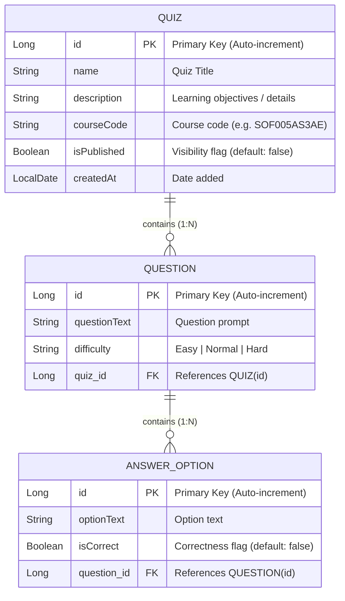

# PROJECT_SPEC.md — Master Product Backlog & Technical Blueprint

This document defines the high-level product vision, domain data contracts, Entity-Relationship (ER) models, API endpoints, and prioritized User Stories for the **Quizzer** platform.

---

## 1. Product Vision

Quizzer is an educational quiz management and delivery platform built for universities and schools.
- **For Teachers**: An administrative dashboard to create and curate course quizzes, formulate challenging questions with customizable difficulty, configure multiple-choice answer options, and control quiz publication.
- **For Students**: A streamlined, modern portal to view active, published quizzes and test their knowledge on course material.

---

## 2. Domain Data Contracts & ER Model



### Detailed Field Specifications

#### `Quiz`
- `id` (Long, Primary Key, Identity): Unique identifier.
- `name` (String, required): Title of the quiz (e.g., *"The Scrum Framework"*).
- `description` (String): Purpose or learning objectives (e.g., *"Learn roles, events, and artifacts"*).
- `courseCode` (String): Institutional course identifier (e.g., *"SOF005AS3AE"*).
- `isPublished` (Boolean, required): Determines visibility to students. `true` = visible/playable; `false` = draft. Default `false`.
- `createdAt` (LocalDate): Timestamp recorded when the quiz was added.
- `questions` (List<Question>): `@OneToMany(mappedBy = "quiz", cascade = CascadeType.ALL, orphanRemoval = true)` with `@JsonIgnore`.

#### `Question`
- `id` (Long, Primary Key, Identity): Unique identifier.
- `questionText` (String, required): The prompt (e.g., *"What is the primary purpose of the Retrospective event?"*).
- `difficulty` (String, required): Allowed values: `"Easy"`, `"Normal"`, `"Hard"`. Default: `"Normal"`.
- `quiz` (Quiz, required): `@ManyToOne(fetch = FetchType.LAZY)` referencing parent `Quiz`.
- `answerOptions` (List<AnswerOption>): `@OneToMany(mappedBy = "question", cascade = CascadeType.ALL, orphanRemoval = true)` with `@JsonIgnore`.

#### `AnswerOption`
- `id` (Long, Primary Key, Identity): Unique identifier.
- `optionText` (String, required): The answer option content (e.g., *"Finding ways to improve the process"*).
- `isCorrect` (Boolean, required): Whether this option is the correct answer. Default: `false`.
- `question` (Question, required): `@ManyToOne(fetch = FetchType.LAZY)` referencing parent `Question`.

---

## 3. API Specifications

### 3.1 Teacher Web MVC Routes (Thymeleaf Templates)

| HTTP Verb | Path | Controller Method | Description / View Rendered |
|---|---|---|---|
| **GET** | `/` or `/quizzes` | `QuizController.listQuizzes()` | Displays list of added quizzes with date, edit/delete links, and add link (`quizzes.html`). |
| **GET** | `/quizzes/add` | `QuizController.showAddForm()` | Renders quiz creation form (`add-quiz.html`). |
| **POST** | `/quizzes/add` | `QuizController.saveQuiz()` | Processes form submission, persists quiz with creation date, redirects to `/quizzes`. |
| **GET** | `/quizzes/edit/{id}` | `QuizController.showEditForm()` | Renders form pre-populated with quiz details (`edit-quiz.html`). |
| **POST** | `/quizzes/edit/{id}` | `QuizController.updateQuiz()` | Saves updated quiz attributes, redirects to `/quizzes`. |
| **GET** | `/quizzes/delete/{id}` | `QuizController.deleteQuiz()` | Cascades deletion of quiz and its child questions, redirects to `/quizzes`. |
| **GET** | `/quizzes/{quizId}/questions` | `QuestionController.listQuestions()` | Renders questions belonging to a specific quiz (`questions.html`). |
| **GET** | `/quizzes/{quizId}/questions/add` | `QuestionController.showAddForm()` | Form to add question to quiz (`add-question.html`). |
| **POST** | `/quizzes/{quizId}/questions/add` | `QuestionController.saveQuestion()` | Saves question linked to quiz, redirects to `/quizzes/{quizId}/questions`. |
| **GET** | `/questions/delete/{id}` | `QuestionController.deleteQuestion()` | Deletes question and cascades to answer options, redirects to quiz's question list. |
| **GET** | `/questions/{questionId}/options` | `AnswerOptionController.listOptions()` | Renders answer options belonging to a question (`options.html`). |
| **GET** | `/questions/{questionId}/options/add` | `AnswerOptionController.showAddForm()` | Form to add answer option (`add-option.html`). |
| **POST** | `/questions/{questionId}/options/add` | `AnswerOptionController.saveOption()` | Saves option linked to question, redirects to `/questions/{questionId}/options`. |
| **GET** | `/options/edit/{id}` | `AnswerOptionController.showEditForm()` | Form to edit answer option text & correctness (`edit-option.html`). |
| **POST** | `/options/edit/{id}` | `AnswerOptionController.updateOption()` | Updates option, redirects back to question's options list. |
| **GET** | `/options/delete/{id}` | `AnswerOptionController.deleteOption()` | Deletes answer option, redirects back to options list. |

### 3.2 Student REST API

| HTTP Verb | Path | Response Type | Description |
|---|---|---|---|
| **GET** | `/api/quizzes` | `200 OK` (JSON Array) | Returns only quizzes where `isPublished == true`. Annotated with `@CrossOrigin(origins = "*")`. |

Sample JSON payload from `GET /api/quizzes`:
```json
[
  {
    "id": 1,
    "name": "The Scrum Framework",
    "description": "Learn about the roles, events and artifacts of the Scrum framework",
    "courseCode": "SOF005AS3AE",
    "isPublished": true,
    "createdAt": "2026-11-06"
  }
]
```

---

## 4. Prioritized Product Backlog (Sprint 1)

The Product Owner has defined the exact implementation priority for Sprint 1:

### Epic 1: Teacher Quiz Management
- **US1**: *As a teacher, I want to add a quiz so that students can learn about course-related topics.*
  - **Acceptance Criteria**: Form contains fields for Name, Description, Course Code, and Published status checkbox. Submitting saves the quiz with the current date and redirects to the quiz list.
- **US2**: *As a teacher, I want to see a list of added quizzes so that I know which quizzes are added.*
  - **Acceptance Criteria**: Front page displays all quizzes with Name, Description, Course Code, Published status, and Date added. Includes action links to Add Quiz, Edit, Delete, and Manage Questions.
- **US3**: *As a teacher, I want to edit a quiz so that I can change its information.*
  - **Acceptance Criteria**: Clicking "Edit" loads the quiz into an edit form with current values pre-filled. Changes persist to the database upon submission.
- **US4**: *As a teacher, I want to delete a quiz so that I can get rid of quizzes I don’t need.*
  - **Acceptance Criteria**: Clicking "Delete" removes the quiz and all associated child entities from the database, redirecting to the updated list.

### Epic 2: Teacher Question Management
- **US5**: *As a teacher, I want to add a question to a quiz so that students can learn about course-related topics.*
  - **Acceptance Criteria**: Form allows inputting question text and choosing difficulty from a dropdown (`"Easy"`, `"Normal"`, `"Hard"`, defaulting to `"Normal"`). The question is linked to the specified quiz.
- **US6**: *As a teacher, I want to see a list of quiz’s questions so that I know which questions the quiz has.*
  - **Acceptance Criteria**: Dedicated page displays all questions belonging to a quiz, showing question text, difficulty, and action links to manage answer options and delete.
- **US7**: *As a teacher, I want to delete a quiz’s question so that I can get rid of questions I don’t need.*
  - **Acceptance Criteria**: Deleting a question removes it and its answer options, returning to the quiz questions list.

### Epic 3: Teacher Answer Option Management
- **US8**: *As a teacher, I want to add an answer option to a question so that students can learn about course-related topics.*
  - **Acceptance Criteria**: Form allows inputting option text and a checkbox for correctness. Persisted linked to the parent question.
- **US9**: *As a teacher, I want to see a list of question’s answer options so that I know which answer options the question has.*
  - **Acceptance Criteria**: Dedicated page displays all options for a question, highlighting correct/incorrect status, with actions to edit and delete.
- **US10**: *As a teacher, I want to delete an answer option so that I can get rid of answer options I don’t need.*
  - **Acceptance Criteria**: Deletes the specified answer option and redirects to the options list.

### Epic 4: Student Dashboard & REST API
- **US11 (Exercise 19-21)**: *As a student, I want to view a list of published quizzes so that I can choose which quiz to take.*
  - **Acceptance Criteria**:
    - Backend exposes `GET /api/quizzes` returning only published quizzes.
    - CORS enabled (`@CrossOrigin(origins = "*")`).
    - `@JsonIgnore` prevents infinite JSON recursion.
    - React/Vite frontend fetches from `/api/quizzes` and renders the list.

