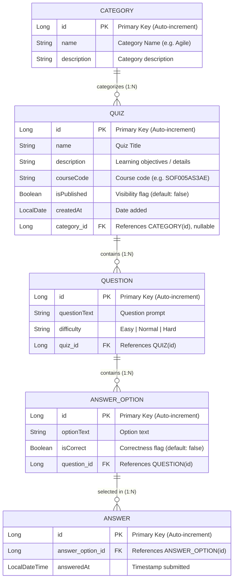

# PROJECT_SPEC.md — Master Product Backlog & Technical Blueprint

This document defines the high-level product vision, domain data contracts, Entity-Relationship (ER) models, API endpoints, frontend routes, and prioritized User Stories for the **Quizzer** platform.

---

## 1. Product Vision

Quizzer is an educational quiz management and delivery platform built for universities and schools.
- **For Teachers**: An administrative dashboard to organize quizzes into categories (create, list, and delete categories), create and curate course quizzes assigned to categories, formulate challenging questions with customizable difficulty, configure multiple-choice answer options, control quiz publication, and inspect quiz results.
- **For Students**: A streamlined, multi-page portal to browse published quizzes and categories, view quiz questions ordered from `Easy` to `Hard`, answer questions with immediate correctness feedback, and inspect aggregated per-question quiz results.

---

## 2. Domain Data Contracts & ER Model

**Implementation status:** Category entity/repository persistence and the nullable `Quiz.category` mapping are implemented. Category services, teacher category forms/assignment, safe deletion workflow, and student category endpoints below remain planned Sprint 2 work.



### Detailed Field Specifications

#### `Category`
- `id` (Long, Primary Key, Identity): Unique identifier.
- `name` (String, required): Category name (e.g., *"Agile"*).
- `description` (String): Purpose or scope of the category (e.g., *"Quizzes related to the Agile principles and project management frameworks"*).
- `quizzes` (List<Quiz>): `@OneToMany(mappedBy = "category")` with `@JsonIgnore` to prevent circular JSON serialization. **No** `CascadeType.REMOVE` or `orphanRemoval` — deleting a category detaches associated quizzes (`quiz.setCategory(null)`) rather than deleting them.

#### `Quiz`
- `id` (Long, Primary Key, Identity): Unique identifier.
- `name` (String, required): Title of the quiz (e.g., *"The Scrum Framework"*).
- `description` (String): Purpose or learning objectives (e.g., *"Learn roles, events, and artifacts"*).
- `courseCode` (String): Institutional course identifier (e.g., *"SOF005AS3AE"*).
- `isPublished` (Boolean, required): Determines visibility to students. `true` = visible/playable; `false` = draft. Default `false`.
- `createdAt` (LocalDate): Timestamp recorded when the quiz was added.
- `category` (Category, optional/nullable): `@ManyToOne` with `@JoinColumn(name = "category_id")` referencing parent `Category`.
- `questions` (List<Question>): `@OneToMany(mappedBy = "quiz", cascade = CascadeType.ALL, orphanRemoval = true)` with `@JsonIgnore` so `GET /api/quizzes` list payloads stay flat.

#### `Question`
- `id` (Long, Primary Key, Identity): Unique identifier.
- `questionText` (String, required): The prompt (e.g., *"What is the primary purpose of the Retrospective event?"*).
- `difficulty` (String, required): Allowed values: `"Easy"`, `"Normal"`, `"Hard"`. Default: `"Normal"`.
- `quiz` (Quiz, required): `@ManyToOne` with `@JoinColumn(name = "quiz_id")` and `@OnDelete(action = OnDeleteAction.CASCADE)` referencing parent `Quiz`.
- `answerOptions` (List<AnswerOption>): `@OneToMany(mappedBy = "question", cascade = CascadeType.ALL, orphanRemoval = true)`. While `Quiz.questions` keeps `@JsonIgnore`, `GET /api/quizzes/{id}/questions` exposes nested `answerOptions` using `@JsonManagedReference` / `@JsonBackReference` (per Exercise 11) or dedicated response DTOs.

#### `AnswerOption`
- `id` (Long, Primary Key, Identity): Unique identifier.
- `optionText` (String, required): The answer option content (e.g., *"Finding ways to improve the process"*).
- `isCorrect` (Boolean, required): Whether this option is the correct answer. Default: `false`.
- `question` (Question, required): `@ManyToOne` with `@JoinColumn(name = "question_id")` and `@OnDelete(action = OnDeleteAction.CASCADE)` referencing parent `Question`.

#### `Answer`
- `id` (Long, Primary Key, Identity): Unique identifier for a student answer submission.
- `answerOption` (AnswerOption, required): `@ManyToOne` with `@JoinColumn(name = "answer_option_id", nullable = false)` and `@OnDelete(action = OnDeleteAction.CASCADE)` so teacher deletion of a quiz, question, or option cascades cleanly without foreign-key violations.
- `answeredAt` (LocalDateTime): Timestamp recorded when the answer is submitted, defaulting to `LocalDateTime.now()`.

---

## 3. API Specifications

### 3.1 Teacher Web MVC Routes (Thymeleaf Templates)

| HTTP Verb | Path | Controller Method | Description / View Rendered |
|---|---|---|---|
| **GET** | `/` or `/quizzes` | `QuizController.listQuizzes()` | Displays list of added quizzes with category, date, edit/delete links, questions link, and add link (`quizzes.html`). |
| **GET** | `/quizzes/add` | `QuizController.showAddQuizForm()` | Renders quiz creation form with category dropdown (`add-quiz.html`). |
| **POST** | `/quizzes/add` | `QuizController.saveQuiz()` | Processes form submission, persists quiz with selected category and creation date, redirects to `/quizzes`. |
| **GET** | `/quizzes/edit/{id}` | `QuizController.showEditQuizForm()` | Renders form pre-populated with quiz details and category dropdown (`edit-quiz.html`). |
| **POST** | `/quizzes/edit/{id}` | `QuizController.updateQuiz()` | Saves updated quiz attributes including category assignment, redirects to `/quizzes`. |
| **GET** | `/quizzes/delete/{id}` | `QuizController.deleteQuiz()` | Cascades deletion of quiz and its child questions/options/answers, redirects to `/quizzes`. |
| **GET** | `/quizzes/{quizId}/questions` | `QuestionController.listQuestions()` | Renders questions belonging to a specific quiz (`questions.html`). |
| **GET** | `/quizzes/{quizId}/questions/add` | `QuestionController.showAddQuestionForm()` | Form to add question to quiz (`add-question.html`). |
| **POST** | `/quizzes/{quizId}/questions/add` | `QuestionController.saveQuestion()` | Saves question linked to quiz, redirects to `/quizzes/{quizId}/questions`. |
| **GET** | `/questions/delete/{id}` | `QuestionController.deleteQuestion()` | Deletes question and cascades to answer options, redirects to quiz's question list. |
| **GET** | `/questions/{questionId}/options` | `AnswerOptionController.listOptions()` | Renders answer options belonging to a question (`options.html`). |
| **GET** | `/questions/{questionId}/options/add` | `AnswerOptionController.showAddOptionForm()` | Form to add answer option (`add-option.html`). |
| **POST** | `/questions/{questionId}/options/add` | `AnswerOptionController.saveOption()` | Saves option linked to question, redirects to `/questions/{questionId}/options`. |
| **GET** | `/options/edit/{id}` | `AnswerOptionController.showEditOptionForm()` | Form to edit answer option text & correctness (`edit-option.html`). |
| **POST** | `/options/edit/{id}` | `AnswerOptionController.updateOption()` | Updates option, redirects back to question's options list. |
| **GET** | `/options/delete/{id}` | `AnswerOptionController.deleteOption()` | Deletes answer option, redirects back to options list. |
| **GET** | `/categories` | `CategoryController.listCategories()` | Displays list of added categories with name, description, delete links, and add link (`categories.html`). |
| **GET** | `/categories/add` | `CategoryController.showAddForm()` | Renders category creation form (`add-category.html`). |
| **POST** | `/categories/add` | `CategoryController.saveCategory()` | Validates and persists category, redirects to `/categories`. |
| **GET** | `/categories/delete/{id}` | `CategoryController.deleteCategory()` | Detaches linked quizzes (`quiz.setCategory(null)`), deletes category, redirects to `/categories`. |

### 3.2 Student REST API

All REST endpoints follow consistent conventions:
- **CORS**: Every REST controller declares `@CrossOrigin(origins = "*")` to allow requests from the React/Vite student dashboard.
- **Error Handling & Validation**:
  - `spring-boot-starter-validation` enforces constraints on request DTOs (`@Valid`, `@NotNull`, etc.).
  - Error responses use `ResponseStatusException` with appropriate HTTP status codes (`400 Bad Request`, `403 Forbidden`, `404 Not Found`) and descriptive messages.
  - Both `application.properties` and `application-rahti.properties` set `server.error.include-message=always` so error messages are included in JSON error payloads.
- **OpenAPI / Swagger Documentation**:
  - Generated via `springdoc-openapi-starter-webmvc-ui:2.8.15` at `/swagger-ui/index.html` and `/v3/api-docs`.
  - Controllers and methods are documented using `@Tag` (`Quizzes`, `Categories`, `Answers`), `@Operation`, and `@ApiResponses`/`@ApiResponse` (with unique `responseCode` entries per `@ApiResponses`).

| HTTP Verb | Path | Status Codes | Description |
|---|---|---|---|
| **GET** | `/api/quizzes` | `200 OK` | Returns only quizzes where `isPublished == true`, including their `category`. |
| **GET** | `/api/quizzes/{id}` | `200 OK`, `404 Not Found` | Returns a single quiz by ID (Exercise 10). Returns `404` if the quiz ID does not exist. |
| **GET** | `/api/quizzes/{id}/questions` | `200 OK`, `404 Not Found` | Returns the quiz's questions with nested `answerOptions`, ordered `Easy` → `Normal` → `Hard` (Exercise 11). Returns `404` if the quiz ID does not exist. |
| **GET** | `/api/quizzes/{id}/results` | `200 OK`, `404 Not Found` | Returns per-question aggregated answer results (`QuestionResultDto[]`, including questions with 0 answers) (Exercise 13). Returns `404` if the quiz ID does not exist. |
| **POST** | `/api/answers` | `201 Created`, `400 Bad Request`, `404 Not Found` | Submits an answer for an answer option (`CreateAnswerDto`: `{ "answerOptionId": 1 }`) and persists it (Exercise 12). Error cases: null/missing `answerOptionId` (`400`), nonexistent `answerOptionId` (`404`), parent quiz not published (`400`/`403`). |
| **GET** | `/api/categories` | `200 OK` | Returns all added categories (Exercise 14). |
| **GET** | `/api/categories/{id}` | `200 OK`, `404 Not Found` | Returns a single category by ID (Exercise 15). Returns `404` if the category ID does not exist. |
| **GET** | `/api/categories/{id}/quizzes` | `200 OK`, `404 Not Found` | Returns only published quizzes belonging to the specified category (Exercise 16). Returns `404` if the category ID does not exist. |

#### Sample JSON Payloads

**`GET /api/quizzes`**
```json
[
  {
    "id": 1,
    "name": "The Scrum Framework",
    "description": "Learn about the roles, events and artifacts of the Scrum framework",
    "courseCode": "SOF005AS3AE",
    "isPublished": true,
    "createdAt": "2026-11-06",
    "category": {
      "id": 1,
      "name": "Agile",
      "description": "Quizzes related to the Agile principles and project management frameworks"
    }
  }
]
```

**`POST /api/answers` Request & Response (`AnswerResponseDto`)**
```json
// Request
{
  "answerOptionId": 1
}

// Response (201 Created)
{
  "id": 42,
  "answerOptionId": 1,
  "questionId": 1,
  "isCorrect": true
}
```

**`GET /api/quizzes/{id}/results` (`QuestionResultDto[]`)**
```json
[
  {
    "questionId": 1,
    "questionText": "What is the capital of Finland?",
    "questionDifficulty": "Easy",
    "totalAnswers": 10,
    "correctAnswers": 9,
    "wrongAnswers": 1
  }
]
```

### 3.3 Student Frontend Routes (React SPA)

The Student Dashboard (`frontend/`) uses `react-router-dom` with a shared top navigation menu (**Quizzes** and **Categories**):

| Path | View / Component | Description |
|---|---|---|
| `/` | Quiz List | Displays published quizzes (name as a link to `/quizzes/:id`, description, course code, category, date added) and a **Results** link (`/quizzes/:id/results`) next to each quiz. |
| `/quizzes/:id` | Quiz Page | Displays quiz name, description, and questions sorted `Easy` → `Normal` → `Hard` with selectable answer options, submit button, and an immediate feedback dialog (e.g., `"That is correct, good job!"` / `"That is not correct, try again"`). |
| `/quizzes/:id/results` | Quiz Results Page | Displays quiz total questions and total answers, plus each question's text, difficulty level, total answers, correct answer percentage, correct answers count, and wrong answers count. |
| `/categories` | Category List | Displays all added categories (accessible from the navigation menu) with category names linking to `/categories/:id/quizzes`. |
| `/categories/:id/quizzes` | Category Quizzes Page | Displays the selected category's name and description along with all published quizzes belonging to that category. |

---

## 4. Prioritized Product Backlog

### Sprint 1 (Completed)

The Product Owner defined the following implementation priority for Sprint 1:

#### Epic 1: Teacher Quiz Management
- **US1**: *As a teacher, I want to add a quiz so that students can learn about course-related topics.*
  - **Acceptance Criteria**: Form contains fields for Name, Description, Course Code, and Published status checkbox. Submitting saves the quiz with the current date and redirects to the quiz list.
- **US2**: *As a teacher, I want to see a list of added quizzes so that I know which quizzes are added.*
  - **Acceptance Criteria**: Front page displays all quizzes with Name, Description, Course Code, Published status, and Date added. Includes action links to Add Quiz, Edit, Delete, and Manage Questions.
- **US3**: *As a teacher, I want to edit a quiz so that I can change its information.*
  - **Acceptance Criteria**: Clicking "Edit" loads the quiz into an edit form with current values pre-filled. Changes persist to the database upon submission.
- **US4**: *As a teacher, I want to delete a quiz so that I can get rid of quizzes I don’t need.*
  - **Acceptance Criteria**: Clicking "Delete" removes the quiz and all associated child entities from the database, redirecting to the updated list.

#### Epic 2: Teacher Question Management
- **US5**: *As a teacher, I want to add a question to a quiz so that students can learn about course-related topics.*
  - **Acceptance Criteria**: Form allows inputting question text and choosing difficulty from a dropdown (`"Easy"`, `"Normal"`, `"Hard"`, defaulting to `"Normal"`). The question is linked to the specified quiz.
- **US6**: *As a teacher, I want to see a list of quiz’s questions so that I know which questions the quiz has.*
  - **Acceptance Criteria**: Dedicated page displays all questions belonging to a quiz, showing question text, difficulty, and action links to manage answer options and delete.
- **US7**: *As a teacher, I want to delete a quiz’s question so that I can get rid of questions I don’t need.*
  - **Acceptance Criteria**: Deleting a question removes it and its answer options, returning to the quiz questions list.

#### Epic 3: Teacher Answer Option Management
- **US8**: *As a teacher, I want to add an answer option to a question so that students can learn about course-related topics.*
  - **Acceptance Criteria**: Form allows inputting option text and a checkbox for correctness. Persisted linked to the parent question.
- **US9**: *As a teacher, I want to see a list of question’s answer options so that I know which answer options the question has.*
  - **Acceptance Criteria**: Dedicated page displays all options for a question, highlighting correct/incorrect status, with actions to edit and delete.
- **US10**: *As a teacher, I want to delete an answer option so that I can get rid of answer options I don’t need.*
  - **Acceptance Criteria**: Deletes the specified answer option and redirects to the options list.

#### Epic 4: Student Dashboard & REST API
- **US11 (Exercise 19-21)**: *As a student, I want to view a list of published quizzes so that I can choose which quiz to take.*
  - **Acceptance Criteria**:
    - Backend exposes `GET /api/quizzes` returning only published quizzes.
    - CORS enabled (`@CrossOrigin(origins = "*")`).
    - `@JsonIgnore` prevents infinite JSON recursion.
    - React/Vite frontend fetches from `/api/quizzes` and renders the list.

---

### Sprint 2 (Active — Deadline: Tuesday 1.12. at 23:59)

#### Epic 5: Teacher Category Management
- **S2-US1 (Exercise 5)**: *As a teacher, I want to add a category so that I can categorize quizzes.*
  - **Acceptance Criteria**: Form at `/categories/add` contains Name (e.g., `"Agile"`) and Description fields. Submitting validates and persists the category and redirects to `/categories`.
- **S2-US2 (Exercise 6)**: *As a teacher, I want to see a list of added categories so that I know which categories are added.*
  - **Acceptance Criteria**: Dedicated page at `/categories` lists all added categories with Name, Description, a Delete button next to each category, an Add Category link, and navigation links between Quizzes and Categories.
- **S2-US3 (Exercise 7)**: *As a teacher, I want to choose a category for a quiz so that I can categorize quizzes.*
  - **Acceptance Criteria**: Both Add Quiz and Edit Quiz forms provide a dropdown menu listing all categories (with optional unassigned choice). The chosen category persists on save/update and displays on the quizzes table.
- **S2-US4 (Exercise 8)**: *As a teacher, I want to delete a category so that I can get rid of categories I don’t need.*
  - **Acceptance Criteria**: Clicking Delete next to a category removes the category from the database without failing on foreign-key constraints and without deleting associated quizzes (associated quizzes have their category set to `null`).

#### Epic 6: Student Dashboard — Quizzes, Taking & Results
- **S2-US5 (Exercise 18)**: *As a student, I want to see a list of published quizzes so that I know which quizzes I can take.*
  - **Acceptance Criteria**: Student dashboard `/` displays published quizzes with Name (as a link to `/quizzes/:id`), Description, Course Code, Category, Date added, and a Results link (`/quizzes/:id/results`) next to each quiz, alongside a navigation menu (`Quizzes`, `Categories`).
- **S2-US6 (Exercises 10, 11, 19)**: *As a student, I want to see the quiz’s questions so that I know its contents.*
  - **Acceptance Criteria**: Backend exposes `GET /api/quizzes/{id}` and `GET /api/quizzes/{id}/questions` (returning questions with nested answer options and `404` when the quiz does not exist). Frontend page `/quizzes/:id` displays quiz name, description, and questions sorted `Easy` → `Normal` → `Hard`.
- **S2-US7 (Exercises 12, 20)**: *As a student, I want to answer the questions of a quiz so that I can learn if my answers are correct.*
  - **Acceptance Criteria**: Backend exposes `POST /api/answers` accepting `{ "answerOptionId": ... }`, persisting the submitted `Answer` and rejecting null option IDs (`400`), missing options (`404`), and unpublished quizzes (`400`/`403`). Frontend lets students choose an answer option per question, submit it, and view a feedback dialog (e.g., `"That is correct, good job!"` or `"That is not correct, try again"`).
- **S2-US8 (Exercises 13, 21)**: *As a user, I want to see the number of correct and wrong answers of each quiz question so that I can inspect its results.*
  - **Acceptance Criteria**: Backend exposes `GET /api/quizzes/{id}/results` returning per-question counts (`questionId`, `questionText`, `questionDifficulty`, `totalAnswers`, `correctAnswers`, `wrongAnswers`), including unanswered questions with zeros (`404` if quiz does not exist). Frontend page `/quizzes/:id/results` displays total quiz questions and total answers, plus each question's text, difficulty, total answers, correct answer percentage, correct count, and wrong count.

#### Epic 7: Student Dashboard — Category Browsing
- **S2-US9 (Exercises 14, 22)**: *As a student, I want to see a list of added categories so that I can browse quizzes in different categories.*
  - **Acceptance Criteria**: Backend exposes `GET /api/categories`. Frontend page `/categories` is accessible from the navigation menu and lists all categories with clickable category names linking to `/categories/:id/quizzes`.
- **S2-US10 (Exercises 15, 16, 23)**: *As a student, I want to see a list of quizzes of a category so that I can browse the quizzes in a category.*
  - **Acceptance Criteria**: Backend exposes `GET /api/categories/{id}` and `GET /api/categories/{id}/quizzes` returning only published quizzes of that category (`404` if category does not exist). Frontend page `/categories/:id/quizzes` displays the category details and its published quizzes with links to take each quiz and view its results.
