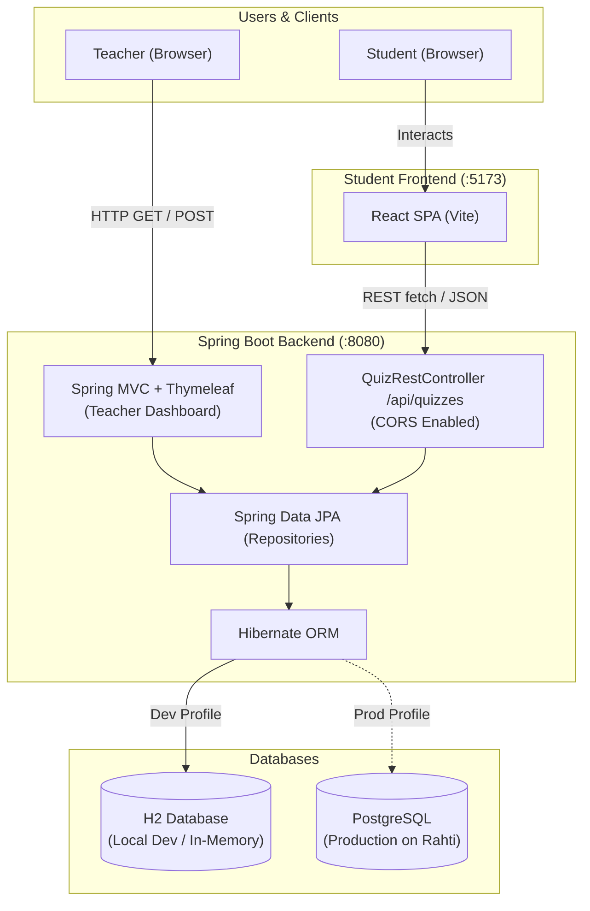

# Quizzer

Quizzer is a full-stack educational quiz platform developed by **Team DevElite**. It enables teachers to author, manage, and publish quizzes with multi-choice questions, and provides students with an interactive client to explore and complete published quizzes.

**Live app:** https://quiz-software-soft-dev-proj.2.rahtiapp.fi/

---

## Architecture Overview



Quizzer is designed as a hybrid full-stack system:
- **Teacher Dashboard (Back Office)**: Built using **Spring Boot MVC** and server-rendered **Thymeleaf** templates for comprehensive quiz, question, and answer option management.
- **Student Dashboard (Client Portal)**: Built as a lightweight Single-Page Application (SPA) using **React (Vite)** that consumes the backend **REST API** to display and interact with published quizzes.
- **Persistence & ORM**: **Spring Data JPA** with **Hibernate** running on an in-memory **H2 Database** for local development, and configured for **PostgreSQL** in production deployment.

---

## Tech Stack

| Component | Technology | Version / Details |
|---|---|---|
| **Language** | Java | 21 (LTS) |
| **Framework** | Spring Boot | 3.4.2 (Spring MVC, Spring Data JPA, Thymeleaf) |
| **Development Database** | H2 Database | In-memory (`jdbc:h2:mem:testdb`) |
| **Production Database** | PostgreSQL | Deployed on Rahti (OpenShift / Kubernetes) |
| **Student Frontend** | React / Vite | JavaScript / TypeScript SPA |
| **Build Tool** | Apache Maven | Maven Wrapper (`./mvnw` / `.\mvnw.cmd`) |

---

## Team Members (Team DevElite)

- [Samir B K](https://github.com/Samir-BK)
- [Prastab Parajuli](https://github.com/Prastab-Parajuli)
- [Toluwalase Ayoola](https://github.com/A2p3kt)
- [Sakibul Islam](https://github.com/sakibul2024)

---

## Project Backlog & Taskboard

- **GitHub Projects Board**: [Team-DevElite Backlog & Sprint Board](https://github.com/orgs/Team-DevElite/projects/1)

---

## Developer Guide

### System Requirements
- **Java Development Kit (JDK)**: Version **21** or later (`java -version`).
- **Git**: Version 2.x or later.
- Optional: Node.js (v18+) for student frontend development.

### How to Run the Backend Locally

1. **Clone the repository**:
   ```bash
   git clone https://github.com/Team-DevElite/Quiz-Software.git
   cd Quiz-Software
   ```

2. **Start the Spring Boot application using Maven Wrapper**:
   - **Windows (PowerShell / Command Prompt)**:
     ```powershell
     .\mvnw.cmd spring-boot:run
     ```
   - **macOS / Linux / Git Bash**:
     ```bash
     ./mvnw spring-boot:run
     ```

3. **Access the application**:
   - **Teacher Dashboard**: [http://localhost:8080](http://localhost:8080)
   - **H2 Database Web Console**: [http://localhost:8080/h2-console](http://localhost:8080/h2-console)
     - **JDBC URL**: `jdbc:h2:mem:testdb`
     - **Username**: `sa`
     - **Password**: *(leave blank)*
   - **Student REST API**: [http://localhost:8080/api/quizzes](http://localhost:8080/api/quizzes)

### Running Automated Tests
```powershell
.\mvnw.cmd test
```

---

## Production Deployment

- **Production Environment**: Deployed on the **Rahti** container cloud platform.
- **Production URL**: *[Deployment URL will be linked here upon completion of Exercise 23]*

---

## Agile Project Documentation

For contributors and AI agents working on this codebase:
- [`AGENT.md`](./AGENT.md) — Operational best practices, architecture constraints, and strict execution protocols.
- [`PROJECT_SPEC.md`](./PROJECT_SPEC.md) — Master product backlog, domain models, entity relationships, and API specifications.
- [`PLAN.md`](./PLAN.md) — Active Sprint Backlog, milestone breakdown, and real-time task checklist.
